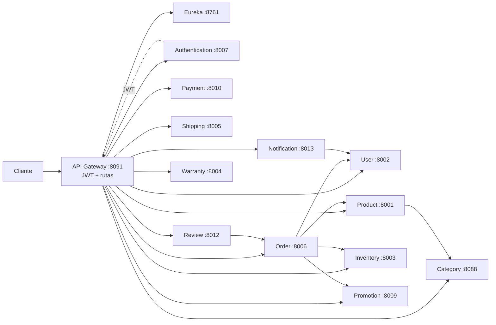

# Ecosistema GameHub Store

Order persiste estados de saga y compensa reservas idempotentes de Inventory y Promotion. Cada microservicio usa PostgreSQL con un esquema propio dentro de `gamehub_store`. El Gateway y los servicios leen credenciales desde `.env`; Eureka resuelve nombres para rutas y clientes Feign.
